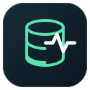
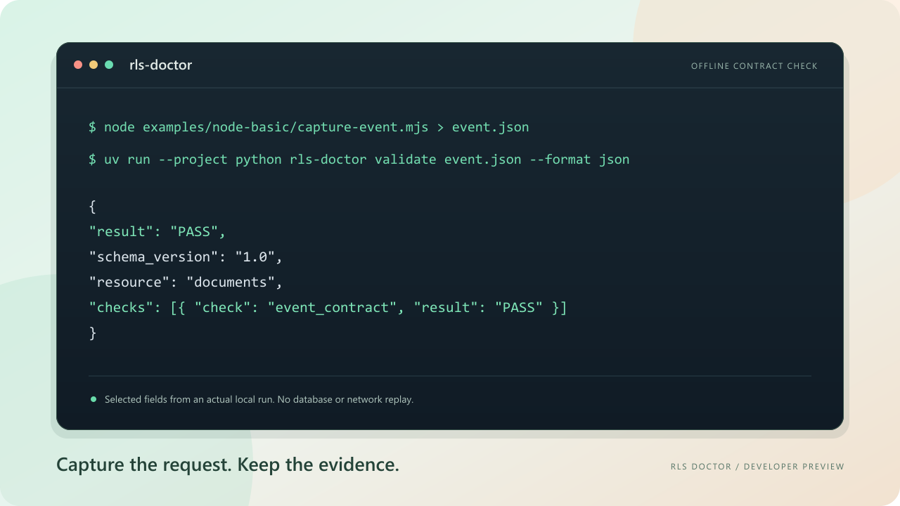

<div align="center">



# RLS Doctor

**Understand unexpected Supabase authorization.**

Capture request metadata. Inspect PostgreSQL access. Replay a local test.<br>
See what happened, what the evidence supports, and what to check next.

[**Quick start**](#quick-start) · [Local replay](#local-replay) · [How it works](#how-it-works) · [Documentation](#documentation) · [Releases](docs/releases.md)


<br><br>



<sub>Development preview. No published release yet. <a href="docs/verification.md">What has actually been verified</a>.</sub>

**English** · [Русский](README.ru.md)

</div>

## What you get

- **Start with the request.** A custom `fetch` for `supabase-js` records a small, versioned description of supported REST GETs. Capture is off until you enable it.
- **Keep secrets out of capture.** No JWTs, cookies, passwords, raw query values or request/response bodies in events. Recording time and storage are bounded.
- **See the database configuration.** Inspect RLS, FORCE RLS, policy roles, permissive/restrictive composition and schema/table/column grants using read-only catalog queries.
- **Reproduce with test identities.** Define synthetic values and expectations in YAML, then run a controlled GET against an approved local Supabase stack.
- **Separate facts from hypotheses.** Findings use `OBSERVED`, `INFERRED`, `UNVERIFIED`. Expectations independently return `PASS`, `FAIL`, `UNKNOWN`, `ERROR`.
- **Use the result in your workflow.** Console reports, JSON and exit codes. No paid API, hosted collector or automatic telemetry.

**A `200` response with `[]` does not prove an RLS denial.** Missing rows, filters and identity context can produce the same symptom. Uncertainty stays visible.

## Quick start

Try SDK → JSON → Python without running a database.

**Tools:** Node.js 22.12+/24, pnpm 11.25.0, Python 3.12+, uv 0.13.5.

```sh
git clone https://github.com/Timon360SB/RLS-Doctor.git
cd RLS-Doctor
pnpm install --frozen-lockfile
uv sync --project python --frozen --group dev
pnpm build

node examples/node-basic/capture-event.mjs > event.json
uv run --project python rls-doctor validate event.json --format json
uv run --project python rls-doctor analyze event.json --expected-role authenticated --format json
```

The real SDK wraps an in-memory Fetch implementation, then Python validates its event. This checks the shared contract; database and network behavior require the separate integration run. Packages are installed from source; npm/PyPI publications are not available yet.

The offline `analyze` command explains captured metadata without credentials or a database.
Its overall result is `UNKNOWN` (exit 2), even when the capture is valid: server-side
identity and an RLS cause require separate evidence.

## Local replay

Prepare the [disposable Supabase fixtures](fixtures/README.md) with Docker and Supabase CLI 2.121.0, then initialize and review the configuration:

```sh
uv run --project python rls-doctor init
uv run --project python rls-doctor doctor
uv run --project python rls-doctor inspect public.documents
uv run --project python rls-doctor replay documents.yaml --inspect --format json
```

`init` creates a disabled config. Before execution, approve the numeric loopback destination, ports and resources, then provide local-test credentials through environment variables. Follow [getting started](docs/getting-started.md) for setup and the full E2E command.

<details>
<summary><strong>A small owner-access scenario</strong></summary>

```yaml
version: 1
name: document_owner_access
environment:
  type: local_supabase
request:
  method: GET
  resource: documents
identity:
  type: authenticated
  token_env: RLS_DOCTOR_TEST_TOKEN
expect:
  status: 200
  row_count: 1
```

Values come from this explicit synthetic scenario, not from redacted production traffic.

</details>

Examples: [missing authorization](examples/missing-auth/scenario.yaml), [default-deny](examples/incorrect-rls/scenario.yaml), [missing GRANT](examples/missing-grant/scenario.yaml), [tenant isolation](examples/tenant-isolation/scenario.yaml). Some deliberately fail an expectation.

## How it works

```text
Supabase request → Capture SDK → Sanitized JSON event
                                       │
                                RLS Doctor CLI
                                       │
                    ┌──────────────────┴─────────────────┐
                    ▼                                    ▼
           PostgreSQL catalogs                   Explicit local GET
                    └──────────────────┬─────────────────┘
                                       ▼
                            Expectations + evidence
                                       ▼
                             Console / JSON report
```

The SDK preserves the original fetch call and response. Inspection does not collect policy expression text or change policies. Replay permits approved local table GETs, disables redirects/proxies, verifies test tokens and uses a trusted fixture probe to confirm the executed role.

Read the [security boundaries](docs/security.md) and [limitations](docs/limitations.md). Loopback forwarding, opaque functions and an untrusted local stack still require operator judgment.

## Project status

| Area | Current evidence |
| --- | --- |
| Capture SDK | 46 local tests passed |
| Python / shared contract | 112 local tests passed |
| PostgreSQL inspector | 8 real integration tests passed on PostgreSQL 17.10 |
| Packaging | Wheel built, installed and used to validate an SDK event through CLI |
| Full Supabase Auth + REST E2E | Remote run failed at API-key validation; local fix awaits full rerun |
| GitHub Actions | 4 Node/Python matrix jobs passed; Supabase job failed before the local fix |
| Independent maintainer review | Pending |

<sub>Local results: 2026-10-23, Python/PostgreSQL refreshed 2026-10-24. Remote CI checked 2026-10-24. These are dated results, not live CI badges. See the <a href="docs/verification.md">verification record</a>.</sub>

Before the first stable release: rerun CI with the API-key fix, complete the Supabase E2E and obtain independent maintainer review. The [release guide](docs/releases.md) covers drafts, pre-releases and versioning.

## Documentation

| Start here | Go deeper |
| --- | --- |
| [Getting started](docs/getting-started.md) · [Manual testing on Windows (RU)](docs/manual-testing.ru.md) | [Architecture](docs/architecture.md) |
| [SDK API](packages/capture-sdk/README.md) | [Security boundaries](docs/security.md) |
| [Fixtures](fixtures/README.md) | [Limitations](docs/limitations.md) |
| [Troubleshooting](docs/troubleshooting.md) | [Research](docs/research.md) |
| [Development](docs/development.md) | [Releases](docs/releases.md) · [Changelog](CHANGELOG.md) |

## Contributing

[Open an issue](https://github.com/Timon360SB/RLS-Doctor/issues) with a sanitized description and synthetic reproduction. Read [CONTRIBUTING.md](CONTRIBUTING.md) before changes and [SECURITY.md](SECURITY.md) before sharing a vulnerability. The TypeScript and Python workstreams share the contract, fixtures and security boundaries. Repository instructions are in [AGENTS.md](AGENTS.md).

## License

[MIT](LICENSE) · RLS Doctor contributors.
