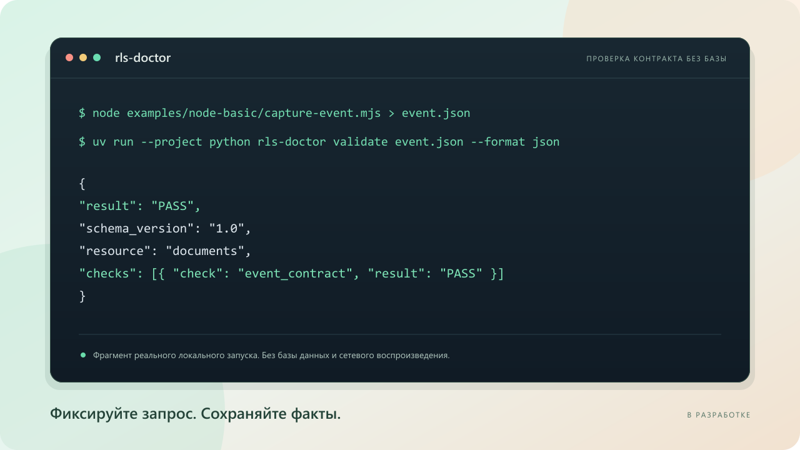

<div align="center">


# RLS Doctor

**Разберитесь, кто и какие данные может читать в вашем Supabase-приложении.**

Соберите метаданные запроса. Проверьте настройки доступа PostgreSQL.<br>
Выполните отдельный локальный тест. Получите ожидания, факты и следующие шаги.

[**Быстрый старт**](#быстрый-старт) · [Возможности](#возможности) · [Свой проект](#подключение-своего-проекта) · [Отчёты](#отчёты-и-результаты) · [Документация](#документация)


<br><br>



<sub>Предварительная версия с целью выпуска v0.1.0. Пакеты и релизы ещё не опубликованы. <a href="docs/mvp-readiness.md">Готовность MVP</a>.</sub>

[English](README.md) · **Русский**

</div>

## Зачем нужен RLS Doctor

Пользователь видит пустой список. Другой пользователь неожиданно получает чужую
запись. Причина может быть в авторизации, SQL-привилегиях, политиках RLS,
отсутствующих данных или фильтрах запроса. RLS Doctor помогает разработчику
разобраться с помощью события запроса, сведений из каталогов и отдельно
заданного локального теста.

**HTTP `200` с `[]` не доказывает запрет RLS.** Отчёт сохраняет эту
неопределённость. Успешный сценарий подтверждает конкретные ожидания;
он не удостоверяет защищённость приложения в целом.

## Возможности

| Возможность | Что делает |
| --- | --- |
| Подключаемый Node.js SDK | Оборачивает `fetch` приложения для `supabase-js`, сохраняет поведение запроса/ответа и отделяет ошибки диагностики |
| Минимальные события | Записывает метаданные REST GET, время, статус, наличие заголовков и нормализованные имена/операторы фильтров; секреты, значения и тела пропускаются |
| Управление записью | Точный список разрешённых источников/ресурсов, остановка, ограничения времени/числа событий и объёма локального JSON-хранилища |
| Анализ события без базы | Проверяет общую схему v1 и объясняет наблюдаемые метаданные без учётных данных PostgreSQL |
| Читающий инспектор PostgreSQL | Проверяет RLS/FORCE RLS, роли, членство, владельца/обход RLS, права схемы/таблицы/столбцов и применимость/составление политик |
| Явный локальный GET-сценарий | Использует синтетический YAML и проверенную тестовую личность; сравнивает HTTP, число строк, наличие/исключение записей и класс ошибки |
| Мастер настройки и управляемые сессии | Создаёт проверенную конфигурацию через вопросы; получает ключи соответствующего локального Supabase в память без ручного копирования |
| Консольные и JSON-отчёты | Разделяет ожидания, факты, выводы и неопределённость; сохраняет UTF-8 JSON напрямую и возвращает устойчивые коды результатов |
| Английский и русский | По умолчанию английский; русский выбирается через `-Language ru` в Windows-запускателях или `--language ru` в CLI |

## Как это работает

```text
Приложение → включённый SDK → очищенное событие → проверка / анализ без базы
                                    │
                                    └── необязательная связь с отдельным сценарием

Ожидания в YAML → разрешённый локальный GET + чтение каталогов PostgreSQL
                                         │
                                         ▼
                              Консольный / JSON-отчёт
```

Сбор события не запускает автоматическое воспроизведение трафика. В событии нет
исходных значений и выбранной схемы/profile базы. Сценарий отдельно задаёт схему,
синтетические значения и ожидания. Доверенный локальный пробник может подтвердить
роль replay; сохранённые заголовки не подтверждают исходного пользователя.

## Быстрый старт

**На Windows рекомендуем начать с учебной лаборатории.** Она подготавливает
отдельный локальный Supabase, двух тестовых пользователей и восемь документов,
затем открывает меню. Ключи копировать не требуется.

### Что нужно установить

| Инструмент | Требование |
| --- | --- |
| Docker | Docker Desktop с работающим Linux-движком для сценариев с базой |
| Node.js | Не ниже 22.12; локальные проверки выполнены на ветках 22 и 24 |
| pnpm | 11.25.0, закреплена в репозитории |
| Python / uv | Python 3.12+ и uv 0.13.5; Windows-запускатель подготавливает Python 3.12 через uv |
| Supabase CLI | 2.121.0; Windows-запускатель находит или загружает закреплённую CLI |

Клонируйте репозиторий или откройте существующую копию. Для клонирования нужен Git.

```powershell
git clone https://github.com/Timon360SB/RLS-Doctor.git
cd RLS-Doctor
.\lab.cmd
```

Ответьте **y** на подготовку базы. Выберите **18** для полного чек-листа из
18 строк либо проходите пункты отдельно. Намеренно неправильные примеры имеют
ожидаемый FAIL/ERROR: чек-лист сверяет нужные доказательства, а не принимает
любую ошибку за успешную проверку.

```powershell
.\lab.cmd -Language ru
.\lab.cmd -Check
.\lab.cmd -Stop
```

Это отдельные варианты: русское меню, полный прогон без меню и остановка.
Выход из меню оставляет базу работающей. Остановка сохраняет данные.
Подготовка создаёт новую пару пользователей и назначает ей восемь тестовых строк;
прежние Auth-пользователи остаются до явного удаления или сброса локальной среды.
Блокировка ОС защищает от двух одновременных запусков лаборатории.

При первом запуске могут загружаться зависимости и Docker-образы. Отсутствующие
системные инструменты показываются с подсказкой; скрытой установки нет.

**Пошаговая проверка:** [English](docs/practice-testing.md) · [Русский](docs/practice-testing.ru.md).

## Примеры и локальные среды

| Точка входа | Назначение | Порты API / базы |
| --- | --- | --- |
| `lab.cmd` | Учебная лаборатория: SDK, пользователи, ошибки доступа, JSON, сессии и настоящие PostgreSQL-регрессии | 55321 / 55322 |
| `demo.cmd` | Короткое меню из шести синтетических примеров авторизации | 54321 / 54322 |
| Приложение с задачами | Настоящий `supabase-js`, установленные пакеты SDK/CLI и собственная схема `task_board` | 56321 / 56322 |

Пример с задачами проверяет две задачи Алисы, одну задачу Боба и отсутствие задач
у анонимного клиента. Пробник роли в public проверяется отдельно от схемы таблицы.
Это наш поддерживаемый пример, а не свидетельство независимого внедрения.

После установки зависимостей из раздела [Разработка](#разработка):

```powershell
uv run --project python python scripts/task_board_check.py --check
uv run --project python python scripts/task_board_check.py --stop
```

Выполняйте команды отдельно. `--check` явно разрешает подготовку синтетического
примера, `--stop` сохраняет его данные. Полные инструкции:
[English](examples/task-board/README.md) · [Русский](examples/task-board/README.ru.md).

Для знакомства **без базы данных** есть [Node-пример](examples/node-basic/README.md):
настоящая обёртка получает ответ от Fetch-реализации в памяти. Анализ события
возвращает UNKNOWN, поскольку исполняемая роль и причина RLS не подтверждены.

## Подключение своего проекта

Используйте одноразовый **локальный Supabase с тестовыми данными**. Сначала
установите зависимости репозитория, затем создайте конфигурацию мастером:

```powershell
uv run --project python rls-doctor init --interactive --directory .rls-doctor/my-project --language ru
```

Проверьте адрес, порты, таблицу, личность и ожидания. Replay выключен, пока вы
явно не одобрите адрес. При неверном ответе повторяется только этот вопрос;
существующие файлы сохраняются. Мастер не подключается, не запрашивает секреты
и не создаёт объекты в базе.

Локальный Supabase своего приложения запустите отдельно. Вместо
`path/to/local-project` укажите папку, содержащую его `supabase/config.toml`:

```powershell
uv run --project python rls-doctor session --config .rls-doctor/my-project/rls-doctor.toml --workdir path/to/local-project --language ru
```

Сессия сверяет сведения CLI с одобренным адресом, держит ключи в памяти процесса
и предлагает выполнить сценарий или проверить таблицу. Если тестовой личности
нет, требуется существующая ссылка на корректный токен либо явное разрешение
на регистрацию синтетического пользователя. Новый пользователь не получает
автоматически права владельца существующих строк приложения.

Мастер оставляет доверенный пробник роли выключенным. Без отдельно проверенного
пробника исполняемая роль не подтверждена и replay может вернуть UNKNOWN.
Сессия не устанавливает пробник, не подготавливает строки, не меняет политики,
не запускает/сбрасывает вашу среду и не сохраняет учётные данные.

Подробнее: [настройка](docs/getting-started.md), сессии на
[английском](docs/managed-session.md) / [русском](docs/managed-session.ru.md).
Подключение SDK разобрано в [API SDK](packages/capture-sdk/README.md) и примере с задачами.

## Команды CLI

При запуске из репозитория перед командами указывается `uv run --project python rls-doctor`.

| Команда | Назначение |
| --- | --- |
| `init --interactive` | Мастер конфигурации и явного синтетического сценария |
| `validate event.json` | Проверка сохранённого события по общей схеме |
| `analyze event.json --expected-role authenticated` | Анализ метаданных без подключения к базе |
| `doctor --config project.toml` | Локальная база/версия, наличие ролей и необязательный доверенный контекст API; расположение таблиц не предполагается |
| `inspect public.documents --role authenticated --config project.toml` | Настройки доступа из каталогов; видимость строк во время запроса остаётся UNKNOWN |
| `replay documents.yaml --inspect --config project.toml` | Синтетический локальный GET с необязательным чтением каталогов |
| `session --config project.toml --workdir local-project` | Получение локальных ключей в память и меню диагностики |

`--help` показывает параметры команды, `--version` — установленную версию.

| Параметр | Где используется |
| --- | --- |
| `--language en` / `--language ru` | Текст настройки/отчётов; поля JSON не переводятся |
| `--format console` / `--format json` | Команды диагностики; JSON для session требует `--run` |
| `--output path/to/report.json` | Команды диагностики; экспорт session требует `--run` |
| `--event path/to/event.json` | Связь события с replay/session; значения по-прежнему задаются YAML |
| `--run` | Один запуск session без меню с кодом результата сценария |
| `--create-test-user` | Явное разрешение на создание синтетического локального Auth-пользователя при необходимости |

Обычные doctor/inspect/replay используют ссылки на переменные окружения с локальными
ключами. Управляемая сессия сама загружает подходящие ключи CLI в область своего
процесса. Оба способа описаны в [Getting started](docs/getting-started.md).

<details>
<summary><strong>Пример: своя запись доступна, чужая исключена</strong></summary>

```yaml
version: 1
name: document_owner_access
request:
  method: GET
  schema: public
  resource: documents
  columns: [id]
identity:
  type: authenticated
  token_env: RLS_DOCTOR_TEST_TOKEN
expect:
  status: 200
  row_count: 1
  contains:
    - column: id
      value: "10000000-0000-4000-8000-000000000001"
  excludes:
    - column: id
      value: "10000000-0000-4000-8000-000000000002"
```

Здесь указаны синтетические ID из фикстур. Перед запуском подготовьте соответствующее
владение строками и учётные данные. Одно совпавшее количество не доказывает,
чья именно запись вернулась.

</details>

## Отчёты и результаты

Консоль показывает ожидания, наблюдения, доказательства о роли/каталогах,
ограничения и следующие шаги. JSON удобен для автоматизации и сохранения в файл:

```powershell
uv run --project python rls-doctor validate path/to/event.json --format json --output .rls-doctor/reports/event-1.json
```

Замените путь к событию на существующий очищенный файл. Отчёт записывается в UTF-8
независимо от кодировки перенаправления PowerShell. Существующий файл отклоняется
до диагностики; выбирайте новое имя для каждого запуска. Можно сохранять и отчёты
об ошибках. Успешное сохранение не меняет код результата и чистый JSON в stdout.

Атомарная запись без перезаписи ограничена 1 МиБ и требует поддержки жёстких
ссылок файловой системой. Ошибка сохранения возвращает ERROR/3. На Windows
действуют ACL папки; новые POSIX-файлы создаются с правами 0600.

| Результат | Код | Значение |
| --- | --- | --- |
| PASS | 0 | Наблюдаемое поведение соответствует явным ожиданиям |
| FAIL | 1 | Ожидание нарушено |
| UNKNOWN | 2 | Доказательств для нужного вывода недостаточно |
| ERROR | 3 | Проверка не выполнена либо входные данные/среда отклонены |

Ожидаемый запрет может дать PASS. Намеренная утечка чужой записи должна дать FAIL.
Корректное событие без подтверждения серверного контекста может дать UNKNOWN.
Отдельные обозначения **OBSERVED**, **INFERRED**, **UNVERIFIED** показывают,
насколько подтверждено каждое диагностическое утверждение.

## Границы и приватность

- Сбор по умолчанию выключен и ограничен поддерживаемыми REST GET к таблицам в Node.js.
  Подключения в браузере, replay записей/удалений, автоматических SQL-исправлений и веб-панели нет.
- В события/отчёты не попадают сырые JWT, ключи, cookies, пароли, тела и значения
  фильтров. SQL-коды из сырых ответов и текст SQL-выражений политик не собираются.
- Replay использует одобренные HTTP-адреса с числовым loopback-IP и разрешённые
  ресурсы/порты. Перенаправления и прокси из окружения отключены.
- Инспектор выполняет читающие транзакции каталогов. Подготовка примеров — отдельное
  явно разрешённое действие, создающее тестовых пользователей/данные.
- Replay ограничен 1000 строками и 1 МиБ; неполный ответ не подтверждает отсутствие записей или общее число строк.
  Произвольные функции, представления и выражения политик нельзя полностью вывести из метаданных.
- Docker/Supabase может публиковать порты на всех интерфейсах компьютера. Loopback-
  проверка исходящих запросов не ограничивает входящие подключения и не обнаруживает перенаправление.

Подробнее: [границы безопасности](docs/security.md), [сообщение об уязвимости](SECURITY.md)
и [ограничения](docs/limitations.md).

## Проверки и готовность к выпуску

Зафиксированные локальные результаты на **25.10.2026**. Точные запуски и версии —
в [журнале проверок](docs/verification.md).

| Часть | Подтверждённые запуски |
| --- | --- |
| SDK | 46 локальных тестов; захват настоящего приложения, проверка установленного архива и записи файла |
| Python / общий контракт | 241 тест на Python 3.12.14/Node 24 и Python 3.13.17/Node 22.23.4 |
| PostgreSQL | По восемь тестов в зафиксированных интеграционных прогонах; проверялись версии 16/17/18 |
| Локальные сценарии | Полный Supabase E2E, 18 строк чек-листа лаборатории и отдельное приложение с собственной схемой |
| Прямой экспорт | У шести команд сверены файл/stdout; на живой среде проверены PASS/FAIL/UNKNOWN/ERROR |
| Сборка пакетов | Wheel, sdist и архив SDK собраны/проверены; установленные SDK и CLI работают вместе |
| Проверки кода | Зафиксированы проверки TypeScript и lint/тесты SDK; последние форматирование/lint и строгие типы Python прошли |

В прогоне 241 теста восемь интеграционных тестов исключены; их реальное выполнение
подтверждено отдельно. Эти записи не являются живыми индикаторами CI.

Все восемь заданий [прогона 40178244545](https://github.com/Timon360SB/RLS-Doctor/actions/runs/40178244545)
прошли для `a91c9d5`. Последующие изменения сохранения preview-сборок требуют
своего удалённого прогона. Workflow настроен на хранение только трёх архивов,
контрольных сумм и манифеста коммита в течение семи дней; [скачивание и приёмка](docs/release-review.ru.md)
будут доступны по описанному порядку после успешного выполнения нового шага.

**До выпуска остаются:** свежий GitHub Actions для текущих изменений, установка
на чистой Windows и независимое воспроизведение/ревью вторым разработчиком.
[Аудит готовности](docs/mvp-readiness.md) сопоставляет реализацию с мастер-промптом.
Порядок публикации описан в [руководстве по релизам](docs/releases.ru.md).

## Разработка

Установите закреплённые зависимости и соберите SDK из корня репозитория:

```powershell
pnpm.cmd install --frozen-lockfile
uv sync --project python --frozen --group dev
pnpm.cmd build
```

В POSIX-терминалах используйте `pnpm` вместо `pnpm.cmd`. После подготовки:

```powershell
pnpm.cmd typecheck
pnpm.cmd lint
pnpm.cmd test
uv run --project python pytest python/tests -m 'not integration' -q
uv run --project python ruff format --check python scripts
uv run --project python ruff check python scripts
```

Проверка пакетов: `uv run --project python python scripts/package_check.py`.
Настоящая совместимость PostgreSQL: `uv run --project python python scripts/postgres_matrix.py --versions 16 18`.
Команды выполняют локальные проверки/сборки, а не публикацию пакетов. Полный E2E,
строгая проверка типов и CI описаны в [инструкции разработчика](docs/development.md).

## Документация

| Тема | Руководства |
| --- | --- |
| Учебная лаборатория | [English](docs/practice-testing.md) · [Русский](docs/practice-testing.ru.md) |
| Управляемые сессии | [English](docs/managed-session.md) · [Русский](docs/managed-session.ru.md) |
| Приложение с задачами | [English](examples/task-board/README.md) · [Русский](examples/task-board/README.ru.md) |
| Настройка и SDK | [Getting started](docs/getting-started.md) · [API SDK](packages/capture-sdk/README.md) · [Node-пример](examples/node-basic/README.md) |
| Устройство и фикстуры | [Архитектура](docs/architecture.md) · [Фикстуры](fixtures/README.md) · [Исследование аналогов](docs/research.md) |
| Диагностика | [Решение проблем](docs/troubleshooting.md) · [Безопасность](docs/security.md) · [Ограничения](docs/limitations.md) |
| Независимая приёмка | [English](docs/release-review.md) · [Русский](docs/release-review.ru.md) |
| Прогресс и выпуск | [Аудит готовности](docs/mvp-readiness.md) · [Проверки](docs/verification.md) · [Релизы](docs/releases.ru.md) · [Изменения](CHANGELOG.md) |

## Участие и лицензия

[Создайте issue](https://github.com/Timon360SB/RLS-Doctor/issues) с очищенным
описанием и синтетическим примером. Правила репозитория — в [AGENTS.md](AGENTS.md),
порядок сообщения об уязвимости — в [SECURITY.md](SECURITY.md).
Не прикладывайте ключи, рабочие строки пользователей и сырой вывод status.

[MIT](LICENSE) · участники RLS Doctor.
